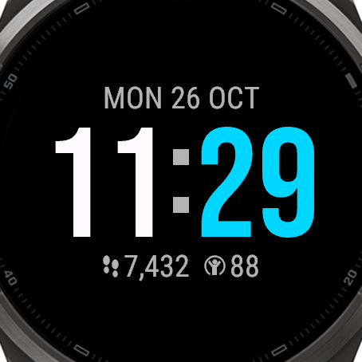

# Noir Time

**A clean, black, AMOLED-friendly watch face for the Garmin fēnix® 8 and fēnix® 9 series and Forerunner® watches.**

Noir Time puts the time front and centre in big, crisp digits on a pure black background, with the date above and your
steps and Body Battery below. Pick the size and colours you like right on the watch or in the Garmin Connect app.

<p align="center">
  
</p>

## Features

- **Date** and **time**, with **separate colours for hours and minutes**
- **Steps** and **Body Battery** with small Garmin-style icons; each can be hidden. The Sensor History permission is used only to display Body Battery; nothing ever leaves the watch.
- **5 time sizes**: Small, Medium, Large, X-Large, XX-Large
- **16-colour palette**
- **Pure black background**, easy on the eyes and the battery
- **Always-on mode**: outline digits at the same size, with burn-in protection
- **Settings on the watch** (watch face menu) or in the Garmin Connect app, in English and Hebrew
- **Runs on 38 watches**: every fēnix® 8 and fēnix® 9 model (AMOLED and Solar) and the round Forerunner® models from the 645 / 935 on; the layout scales to each screen (208 to 466 px). See [the device list](store/description.md) and [screenshots per device](docs/screenshots/devices/)

## Build

You need the [Connect IQ SDK](https://developer.garmin.com/connect-iq/sdk/) (9.3.0 or newer) and a developer key.

```sh
scripts/keygen.sh     # once: creates your developer key
scripts/build.sh      # -> build/NoirTime.prg (fenix9pro47mm; CIQ_DEVICE=<id> for another) and build/NoirTime.iq (all watches)
```

## Install

Connect the watch over USB, copy `build/NoirTime.prg` to the watch's `GARMIN/APPS` folder, eject, then pick
**Noir Time** from the watch faces list.


## More

- [Developer guide](docs/DEVELOPMENT.md): simulator, tests, battery profiling, CI, publishing
- [DECISIONS.md](DECISIONS.md): every technical decision, with the Garmin docs it is based on
- [Screenshots](docs/screenshots/) and the [burn-in report](docs/burn-in-report.md)

## Security

To report a vulnerability, see [SECURITY.md](SECURITY.md).

## License

Noir Time © 2026 reubinoff is licensed under the
[GNU General Public License v3.0 (GPL-3.0)](https://www.gnu.org/licenses/gpl-3.0.html).
Any copy or modified version you distribute must also be released under GPL-3.0, with its source code.
See [LICENSE](LICENSE) for the full text.

Garmin, fēnix, Forerunner and Body Battery are trademarks of Garmin Ltd. This project is not affiliated with Garmin.
